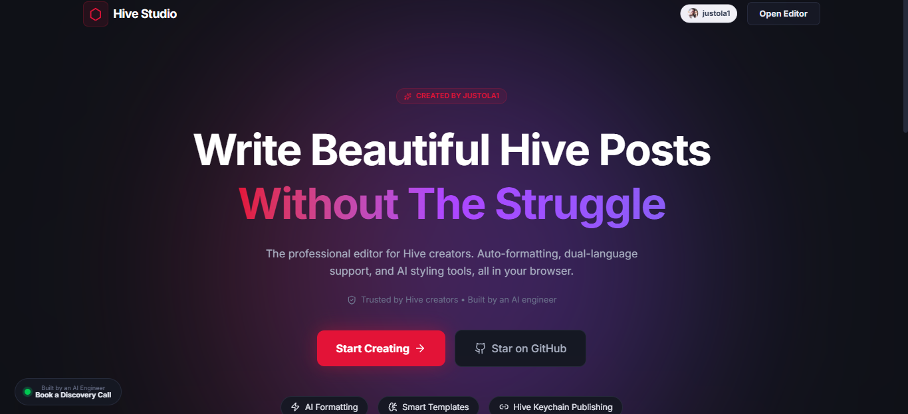
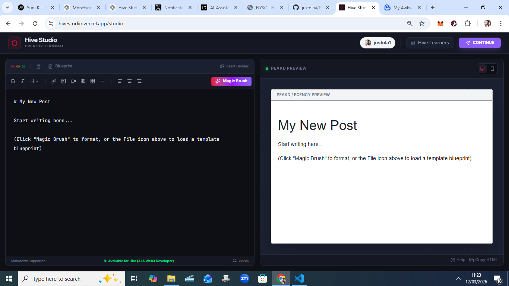
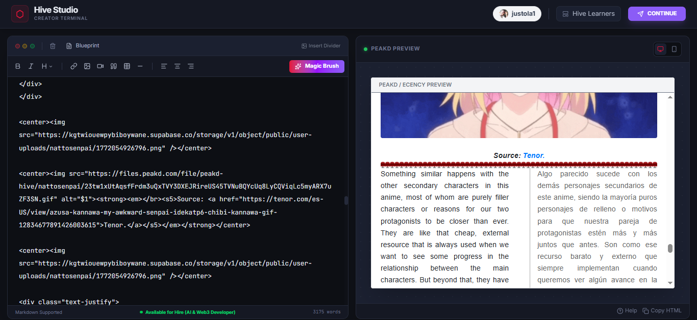
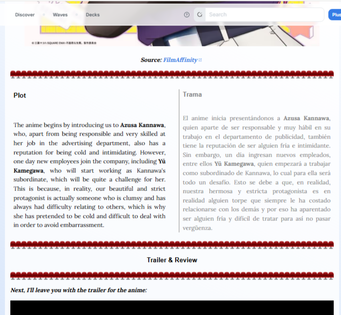

# 🐝 Hive Studio




> **AI-Powered Markdown Editor for the Hive Blockchain**

Hive Studio is a modern web application that solves one of the biggest problems in Web3 blogging: **writing and formatting complex markdown posts.**

It features an **AI Layout Engine ("Magic Brush")** that automatically transforms raw text into **beautiful, Hive-compatible HTML layouts** without changing the author’s original words.

Instead of fighting markdown syntax, creators can focus purely on writing.

🌐 **Live Demo:**  
https://hivestudio.vercel.app

💬 Hive Community Discussion:  
[Hive-Link](https://ecency.com/hive-139531/@justola1/yhhwaysbdz?referral=justola1)

---

# ✨ Features

## 🪄 Magic Brush AI

The **Magic Brush AI** uses Google's **Gemini 2.5 Flash Lite** to intelligently structure content.

It can:

- Detect topics and headers
- Auto-format markdown
- Generate tables
- Create bilingual layouts
- Preserve the author's exact wording

Think of it as **"Prettier for Hive blog posts."**

---

## 🎨 Dynamic Template Engine

Hive Studio includes a template system that allows creators to instantly apply beautiful layouts.

Examples:

- Magazine layout
- Crypto analyst report
- Story blog layout
- Dual-language post layout

Templates are stored and managed using **Supabase**.

---

## 🌍 Dual-Language Support

Many Hive creators write in **multiple languages**.

Hive Studio makes this simple with:

- Side-by-side language columns
- Automatic formatting
- Responsive mobile layout

---

## 🗂️ Integrated Media Manager

Upload and embed media directly inside the editor:

- Images
- Short videos
- YouTube embeds
- 3Speak videos

Media files are stored in **Supabase Storage**.

---

## 🔗 Direct Blockchain Publishing

Hive Studio integrates with **Hive Keychain** to publish directly to the Hive blockchain.

Benefits:

- Secure signing
- Zero transaction fees
- Private keys never leave the user's device

---

# 🛠️ Tech Stack

## Frontend

- React (Vite)
- Tailwind CSS v4
- Lucide Icons
- Remark
- Remark-GFM

## Backend & Infrastructure

- Supabase
- PostgreSQL
- Supabase Storage
- Supabase Edge Functions
- Vercel Hosting

## Web3 Integration

- @hiveio/keychain-sdk
- Hive Public API

## AI Integration

- @google/generative-ai
- Gemini 2.5 Flash Lite

---

# 🔒 Security & Privacy

Hive Studio was built with **Web3 security principles**.

### No Private Keys Stored
Publishing is handled through **Hive Keychain**, meaning keys never touch the server.

### Secure AI Calls
The Gemini API is accessed through **Supabase Edge Functions**, preventing API key exposure.

### XSS Protection
The preview system uses a **sandboxed iframe** and sanitizes HTML before rendering.

### Privacy Friendly Analytics
Only lightweight conversion analytics are used.

---

# 🖼️ Screenshots

### Editor


### Magic Brush AI


### Hive Post Preview


---

# ⚙️ Architecture Overview

```
User
 │
 │ React + Tailwind (Vite)
 │
 ├── Markdown Editor
 ├── Magic Brush AI
 ├── Live Preview Renderer
 │
 ▼
Supabase Backend
 ├── PostgreSQL Database
 ├── Storage Buckets
 ├── Edge Functions
 │
 ▼
Hive Blockchain
 └── Publishing via Hive Keychain
```

---

# 🚀 Run Locally

### Clone the repository

```bash
git clone https://github.com/YOUR_USERNAME/hive-studio.git
```

### Install dependencies

```bash
npm install
```

### Setup environment variables

Create a `.env` file in the root directory.

```
VITE_SUPABASE_URL=your_supabase_url
VITE_SUPABASE_ANON_KEY=your_supabase_anon_key
```

### Start development server

```bash
npm run dev
```

---

# 🎯 Why This Project Exists

Web3 blogging platforms like **Hive** are powerful but difficult for new creators because of **markdown complexity**.

Hive Studio bridges that gap by combining:

- AI formatting
- Beautiful layouts
- Direct blockchain publishing

This makes **Web3 content creation dramatically easier.**

---

# 👨‍💻 Author

Built by **Olamide Idowu**

Full-stack developer focused on **AI tools, Web3, and modern SaaS products.**

Hive: https://peakd.com/@justola1  
GitHub: https://github.com/justolaa  
Email: idowuolamide81@gmail.com  

---

# 🤝 Contributing

Contributions are welcome.

1. Fork the repository
2. Create a feature branch
3. Submit a pull request

---

# ⭐ Support the Project

If you find this project useful:

⭐ Star the repository  
🐝 Share it with Hive creators  
🚀 Build something on top of it
